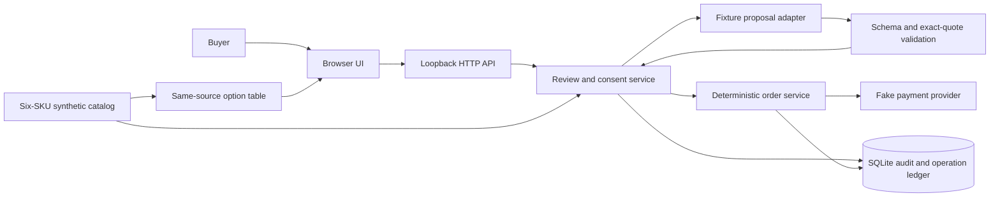

# CartReadback

**Check the keyboard you chose before checkout.**

CartReadback compares a selected product with up to two requirements the buyer
already has, such as a UK keyboard layout or an included USB-C cable. It shows
what the description supports, what conflicts, and what the seller has not stated.

> **Documentation and API-contract scaffold only; no runnable app yet.**
> The application, browser UI and evaluation tools are pending import.

Start with the [project brief](PROJECT_BRIEF.md), [API contract](cart_readback/API_CONTRACT.md)
or [contributing guide](CONTRIBUTING.md).

## Why this exists

An ISO keyboard shape does not establish a UK language layout. A pictured or
compatible cable does not establish that it is included. These distinctions can
be easy to miss when checking a product description before paying.

The first scope is deliberately small: one merchant, six synthetic keyboard SKUs,
one item per order, and language-layout/included-cable conditions only. This is
not a recommendation engine, price finder, compatibility guarantee, or connection
to arbitrary shops.

**Illustrative readback, not a fixture quotation or test result:** the buyer
requires a UK language layout, but the description establishes only an ISO
physical shape. The result should be `unknown`, not `match`. Acknowledging that
unknown does not establish that the keyboard has a UK language layout.

A clear option-and-included-items table is the baseline, using **the same source
material** as the readback. AI earns a place only if it helps more than that table
after preparation, requirement entry, reading and correction effort are included.
Customer demand and that benefit have not been established.

## What the local fixture demonstrates

These features are **pending import here**, not capabilities of this scaffold:

- Review the selected SKU against one or two explicit requirements, beside the
  same-source product table.
- Display `match`, `conflict` or `unknown` proposals, with exact source quotations
  where evidence exists. The proposal adapter is a deterministic test double,
  not genuine AI inference.
- Require separate buyer acknowledgement of each conflict or unknown fact.
  Acknowledging uncertainty never changes it into a match.
- Bind confirmation to the reviewed SKU, source, conditions and prices. A changed
  snapshot invalidates old consent.
- Simulate order creation, approval, verification and final capture as separate
  actions. The server owns quantity and integer USD cents; suggestions cannot
  authorize a payment.
- Persist operation identities in SQLite. An ambiguous outcome stays
  `PAYMENT_UNKNOWN`; reconciliation checks the same known order rather than
  creating a replacement payment. There is no cancel/restart flow after creation.

**All catalog data, proposals and payment responses in that build are fixtures.
No PayPal call, genuine model call or money movement occurs.**

## Architecture

One loopback Python service, SQLite and a same-origin vanilla browser UI. This
diagram describes the local fixture design to be imported, not deployed services.



The proposal adapter has no payment authority or credentials. Exact-quote and
schema validation cannot prove semantic correctness. Real-model and PayPal sandbox
interfaces are disabled; there is no live-payment fallback.

## Quickstart after the server and UI imports

**Not available in this scaffold.** Use these commands only on a branch containing
`cart_readback/cartreadback_app/` **and** `cart_readback/ui/`. A server-only import
supports API testing, not the browser demo.

Requirements: Python 3.11+ and a browser. Runtime uses the Python standard library;
no package installation, API keys, accounts or UI build step are required.

From the repository root:

```sh
cd cart_readback
python -m cartreadback_app --port 8765 --db .local/cartreadback.sqlite3
```

Open **http://127.0.0.1:8765**, not `localhost`: Host and Origin checks use that
exact address. Choose a keyboard, add one or two requirements, compare the table
and readback, then deliberately confirm any simulated checkout actions. Stop the
server with `Ctrl-C`. Keep `.local/` private; its database stores local sessions
and order history. Do not expose this demo server publicly or erase an unresolved
checkout to manufacture a fresh success.

## Checks after each component is imported

The scaffold has no application tests to run. The commands below are the check
entry points for later imports, **not results for this branch**. Run them from
`cart_readback/`; they require no real model or payment service.

**Server and independent Python checks:**

```sh
python -m unittest discover -s tests -v
python -m unittest discover -s review -p 'test_independent_*.py' -v
python -m compileall -q cartreadback_app tests scripts review
python scripts/smoke_http.py
python scripts/smoke_http.py --fault capture_timeout_after_success
python scripts/smoke_http.py --fault capture_timeout_before_success
python scripts/smoke_http.py --fault create_timeout_after_success
```

**UI checks:** Use [Node.js 22+](https://nodejs.org/download/release/v22.15.0/docs/api/globals.html)
with global `fetch`, `structuredClone` and
[`crypto.randomUUID`](https://nodejs.org/download/release/v22.15.0/docs/api/webcrypto.html#cryptorandomuuid)
available. No `npm install` is needed. The wrapper starts an actual temporary
loopback server for the HTTP cases; running the Node HTTP file alone without its
test origin can skip those cases.

```sh
python ui/check.py
node --test review/test_independent_ui.mjs
```

These cover static markup, logic, a minimal DOM and local HTTP, not real browser
rendering, native keyboard behavior or accessibility certification.

**Offline evaluation tooling:**

```sh
python eval/score.py validate
python -m unittest discover -s eval -p 'test_score.py' -v
python -m compileall -q eval
```

The scorer validates and scores supplied predictions; it never calls a model.
Optional development lint uses the pinned Ruff 0.14.3 requirement in the server
import; it is not a runtime dependency. Record actual commands, exits, skipped
cases and the exact reviewed revision rather than carrying old passes forward.

## Evidence and release limits

| Area | Current evidence or missing gate |
| --- | --- |
| This branch | Documentation/API-contract scaffold; no executable import or app-test claim. |
| Local fixture | Pre-existing synthetic implementation and local checks; not validation of a future imported revision. |
| Prompt exploration | An app-external, uncontrolled native-agent pilot used a synthetic set. That set is now exposed regression material, not a fresh hidden holdout; no prompt-performance winner is claimed. |
| Real AI | Actual application model adapter and fresh semantic-grounding evaluation are still unverified. |
| PayPal | Actual sandbox order/approval/requery/capture and timeout recovery are still unverified. |
| Buyer experience | Rendered wide/narrow viewport, native keyboard, interrupted-flow and real-user baseline comparison remain open. No verified screenshot or working integration video is supplied. |
| Publication | Open-source license/provenance, public release and contest submission require separate review and authority. |

This is preparation for a contest project, **not a working AI + PayPal integration
release or a production checkout system**.

## Contributing and AI assistance

The [import ledger](docs/IMPORT_PROVENANCE.md) records pre-existing local work,
source revisions and subsequent import/review changes. An import does not
retroactively establish issue-first development or reviewed GitHub history.

Use a real issue, a scoped branch and a draft PR when repository work is
authorized. A separate review worker checks the artifact and reruns relevant
checks; findings can be discussed in the task, a shared review note or PR comments.
The PR summarizes the evidence and unresolved items, not an invented approval.

AI tools assisted planning, implementation, documentation and review of the local
work. AI role names describe responsibilities, not separate human contributors or
GitHub identities. Disclose material assistance and verification limits in the
actual PR body; do not add AI authorship or coauthor commit trailers. A same-account
worker review does not supply independent-account approval or permission to merge,
publish, deploy, spend money or submit the project.
